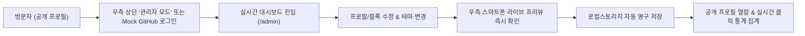

# [PRD] 마이링크 (MyLink) - 개발자 특화 링크트리 플랫폼 (클라이언트 데모 버전)

---

## 1. 개요 (Executive Summary)

### 1.1 제품 소개
**마이링크(MyLink)**는 개발자와 테크 크리에이터를 위해 최적화된 올인원 프로필 링크 서비스입니다.  
별도의 백엔드/클라우드 설정 없이도 즉시 브라우저에서 모든 기능(가상 인증, 실시간 대시보드 편집, 테마 변경, 링크 클릭 통계)을 체험할 수 있는 **Mock 데이터 및 LocalStorage 기반 클라이언트 전용 데모**로 구축됩니다.

### 1.2 비전 & 가치 제안 (Value Proposition)
- **Zero-Setup 즉시 체험:** 데이터베이스나 API 키 설정 없이 브라우저 로컬 저장소를 활용해 완전한 링크트리 워크플로우 경험
- **개발자 아이덴티티 극대화:** GitHub 저장소, 잔디(Contributions), 기술 스택 뱃지, 프로젝트 쇼케이스를 한 화면에 매력적으로 시각화
- **압도적인 디자인 시스템:** Spotify Dark(기본), GitHub Dark, VS Code, Minimal Light 등 4종 테마 지원
- **실시간 WYSIWYG 대시보드:** 좌측 편집 패널 + 우측 실시간 모바일 목업 라이브 프리뷰
- **로컬 분석 통계:** 방문자 수(PV) 및 링크별 클릭 수를 로컬스토리지에 기록하여 시각화

---

## 2. 타깃 고객 및 사용자 페르소나

1. **개발자 & 테크 크리에이터:** 이력서, 포트폴리오, 깃허브, 블로그를 하나의 감각적인 링크로 모으고 싶은 엔지니어
2. **프로토타입 평가자 / 채용 담당자:** 별도 가입 절차 없이 브라우저 상에서 즉시 동작하는 완성형 인터페이스를 검토하고자 하는 사용자

---

## 3. 핵심 사용자 흐름 (Core User Journey)



---

## 4. 핵심 기능 요구사항 (Functional Requirements)

### 4.1 가상 인증 및 세션 관리 (Mock Auth)
- **FR-1.1 Mock GitHub 로그인:**
  - 원클릭으로 GitHub 개발자 계정(`@developer`) 가상 로그인/로그아웃 전환
  - 로그인 상태는 `localStorage`에 영구 보존되어 새로고침 후에도 유지
- **FR-1.2 프로필 기본값 및 초기화:**
  - 기본으로 완성도 높은 개발자 프로필 Mock 데이터가 즉시 로드됨
  - "기본 데이터로 초기화(Reset)" 버튼을 통해 언제든 최초 상태로 복구 가능

### 4.2 개발자 특화 블록 시스템 (Block CMS)
- **FR-2.1 일반 링크 카드:** 타이틀, 설명, URL, 이모지 아이콘, 클릭수 추적
- **FR-2.2 GitHub 블록:**
  - Pinned Repository 카드 (Star 수, Fork 수, 주요 언어 표시)
  - GitHub 잔디(Contribution) 시각화 위젯
- **FR-2.3 기술 스택 뱃지 클러스터:** TypeScript, React, Next.js, Node.js 등 태그 추가/삭제
- **FR-2.4 프로젝트 쇼케이스 카드:** 썸네일, 프로젝트 명, 설명, [Demo], [Code] 버튼
- **FR-2.5 소셜 아이콘 바:** GitHub, Blog, LinkedIn, X, Email 등
- **FR-2.6 블록 순서 조정 & 토글:** 위/아래 순서 변경 버튼 및 개별 블록 활성/비활성화 스위치

### 4.3 테마 프리셋 시스템 (Themes)
- **Spotify Dark (Default):** `#121212` 배경, `#1ed760` Spotify Green, 원형/알약형 버튼, 하단 Now-Playing 바
- **GitHub Dark:** `#0d1117` 배경, `#238636` 깃허브 그린, 코드 감성 뱃지
- **VS Code Monokai:** 코드 에디터 신스웨이브/다크 톤
- **Minimal Light:** 고대비 클린 화이트/블랙 미니멀 테마

### 4.4 실시간 관리자 대시보드 (Admin Dashboard)
- **좌측 편집기:**
  - 탭 분리: [블록 관리], [프로필/테마 설정], [통계 분석]
  - 신규 블록 추가 모달 / 폼
- **우측 라이브 프리뷰:**
  - 실제 아이폰/갤럭시 형태의 모바일 목업 뷰어
  - 좌측에서 입력한 내용이 딜레이 없이 100% 실시간으로 렌더링

### 4.5 로컬 통계 분석 (Analytics)
- 프로필 총 조회수(PV) 자동 카운팅
- 각 링크 버튼 클릭 시 해당 링크의 `clickCount`를 1씩 증가시키고 로컬스토리지에 저장
- 대시보드 통계 탭에서 링크별 클릭 순위 및 통계 카드 실시간 조회

---

## 5. 시스템 아키텍처 및 데이터 스토리지 사양

| 영역 | 기술 스택 | 설명 |
| :--- | :--- | :--- |
| **Framework** | **Next.js 16 (App Router)** | 컴포넌트 기반 UI 아키텍처 |
| **Language** | **TypeScript 5** | 데이터 타입 및 상태 관리 인터페이스 정의 |
| **Styling** | **Tailwind CSS v4** | Spotify 디자인 시스템 및 4대 테마 동적 스타일링 |
| **Data Storage** | **LocalStorage API** | 브라우저 영구 저장 (`mylink_profile_data`, `mylink_analytics`) |
| **Mock Engine** | **TypeScript Mock Factory** | 최초 로드 시 고품질의 기본 개발자 프로필 데이터 자동 공급 |
| **State Management** | **React Hooks & Custom Storage Hook** | 탭 간 / 컴포넌트 간 실시간 동기화 |

---

## 6. 데이터 모델 (LocalStorage Schema)

```typescript
// LocalStorage Key: "mylink_profile_data"
interface ProfileData {
  user: {
    username: string;
    fullName: string;
    role: string;
    bio: string;
    avatar: string;
    verified: boolean;
    monthlyCommits: number;
    reposCount: number;
    uptime: string;
  };
  theme: "spotify-dark" | "github-dark" | "monokai" | "minimal-light";
  socialLinks: {
    github?: string;
    blog?: string;
    email?: string;
    linkedin?: string;
  };
  blocks: BlockItem[];
}

interface BlockItem {
  id: string;
  type: "link" | "github_repo" | "tech_stack" | "project";
  title: string;
  subtitle?: string;
  url?: string;
  icon?: string;
  badge?: string;
  pinnedRepo?: {
    name: string;
    stars: number;
    forks: number;
    language: string;
    color: string;
  };
  techStack?: string[];
  project?: {
    demoUrl?: string;
    githubUrl?: string;
    tags: string[];
  };
  clicks: number;
  isActive: boolean;
}
```

---

## 7. 구현 로드맵
1. **Mock Data & Storage Helper 작성:** `src/lib/storage.ts`, `src/lib/mockData.ts`
2. **테마 시스템 구현:** Spotify, GitHub, Monokai, Minimal Light 클래스/스타일 매핑
3. **통합 대시보드 구현 (`/admin`):**
   - 프로필 정보 편집, 블록 추가/수정/삭제/순서변경, 테마 선택기, 통계 차트
   - 우측 실시간 모바일 목업 프리뷰
4. **공개 프로필 페이지 (`/` 및 `/@username`):**
   - 로컬스토리지 데이터를 실시간 구독하여 렌더링
   - 링크 클릭 시 카운팅 처리 및 상단 "대시보드로 가기" 퀵 토글 제공
